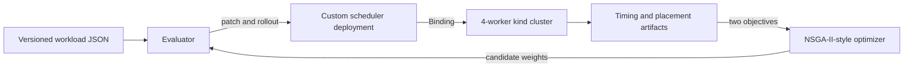

# evo-sched

`evo-sched` is a research scheduler that connects a parameterized Kubernetes
node-scoring policy to live multi-objective evolutionary search. Candidate
policies are deployed into a running kind cluster, evaluated through real Pod
bindings, and compared using scheduling-decision latency and workload
consolidation.

The central result is deliberately negative: none of the five optimizer
finalists that looked Pareto-optimal after one live evaluation remained
nondominated when the same policies were evaluated ten times per training
workload. An independent holdout still produced a stable hand-designed policy
tradeoff spanning four, three, and two workload-occupied workers. The project
therefore demonstrates both a real policy surface and the need to model
measurement uncertainty during live-cluster optimization.

## Research status

The official V2 evidence is complete and frozen in version-controlled artifacts.

| Stage | Protocol | Main outcome |
| --- | --- | --- |
| Baselines | 4 schedulers x 3 workloads x 3 repeats | Placement character separates; default kube-scheduler is an external placement reference |
| Evolutionary search | 216 optimizer candidates, seeds 42/123/999 | Every one-shot seed appears to find novel Pareto points |
| Repeated validation | 8 policies x 3 workloads x 10 repeats | None of 5 optimizer finalists remains nondominated |
| Independent holdout | 3 baselines x 1 unseen workload x 10 repeats | Spread, balanced, and consolidation policies occupy 4, 3, and 2 workers |

The latency confidence intervals overlap. The paper does not claim statistical
latency superiority, optimizer generalization, or superiority over the default
Kubernetes scheduler.

## System



The scheduler filters infeasible nodes before scoring. Its V2 policy uses four
nonnegative weights normalized to sum to one:

- `FreeCPU`: post-placement free CPU fraction
- `FreeMem`: post-placement free memory fraction
- `Balance`: preference for complementary CPU-memory residuals
- `Consolidation`: preference for workers already hosting managed workload Pods

The highest-scoring feasible node is selected, with node name as a deterministic
tie-breaker. Only the scoring weights change during an experiment; filtering,
workloads, cadence, and measurement contracts remain fixed.

## Repository map

| Path | Purpose |
| --- | --- |
| `scheduler/main.go` | Custom scheduler and V2 scoring implementation |
| `scheduler/cmd/evaluator` | Workload replay, rollout, cleanup, and measurements |
| `scheduler/cmd/optimizer` | NSGA-II-style candidate search |
| `scheduler/cmd/multi-seed-runner` | Provenance-gated official multi-seed runs |
| `scheduler/cmd/repeated-validation-runner` | Repeated finalist and holdout protocols |
| `workloads/v2/` | Three training regimes and one unseen holdout workload |
| `experiments/weights-v2.json` | Canonical V2 baseline policies |
| `results/` | Raw JSON/CSV, summaries, checksums, and run manifests |
| `paper/main.tex` | IEEE conference paper source |
| `paper/evidence-audit-v2.json` | Machine-readable claim-to-evidence closure audit |
| `WALKTHROUGH.md` | Full decision, failure, recovery, and experiment ledger |

## Tested environment

The official runs record exact versions and checksums in their manifests. The
main environment was:

- Kubernetes and kind node image: `v1.35.0`
- kind: `v0.31.0`
- Go toolchain and scheduler builder: `1.25`
- `client-go`, `k8s.io/api`, and `k8s.io/apimachinery`: `v0.35.0`
- Docker Engine: `29.7.2`
- evaluator image: `busybox:1.36.1`
- topology: one control-plane and four homogeneous workers

For local verification, install Go 1.25+, Git, `jq`, `rg`, `latexmk`, `qpdf`,
and Poppler (`pdfinfo` and `pdffonts`). Live runs additionally require Docker,
kind, and kubectl with access to the `kind-evo-sched` context.

## Verify committed evidence

The fastest reproducibility path does not start Kubernetes or rerun the expensive
optimizer. It reruns tests and analysis tools, compares regenerated summaries to
the committed artifacts, rebuilds the paper, and checks the PDF:

```bash
make verify
```

This command writes only to a temporary directory and ignored LaTeX build files.
It handles the documented schema evolution between the original baseline summary
and the current summarizer while requiring all shared numerical fields to match.

Individual checks are also available:

```bash
make test
make vet
make paper
```

## Live smoke test

The following command starts or creates the 4-worker cluster, builds and loads
the scheduler image, deploys RBAC and the scheduler, and runs a small V2 wiring
smoke test:

```bash
make live-smoke
```

This is a functional check, not paper evidence. It leaves the cluster running so
the scheduler and logs can be inspected:

```bash
kubectl -n evo-sched get pods
kubectl -n evo-sched logs deployment/evok8s-scheduler
```

Stop the kind containers without deleting cluster state when finished:

```bash
make cluster-stop
```

## Reproduce live protocols

Official runners intentionally refuse dirty working trees and require an
annotated protocol tag at `HEAD`. They also refuse cluster topology, scheduler
cadence, canonical-weight, rollout, or namespace-cleanliness drift. Use a new run
name and tag; never overwrite the committed official directories.

Prepare the cluster and the 250 ms experiment cadence:

```bash
make cluster-up
make scheduler-image
make scheduler-deploy
cd scheduler
go run ./cmd/scheduler-admin --interval 250ms
cd ..
git tag -a protocol-v2-reproduction-YYYYMMDD -m "V2 reproduction protocol"
```

Run the three-seed search from `scheduler/`:

```bash
go run ./cmd/multi-seed-runner \
  --run-name YYYY-MM-DD-v2-reproduction-optimizer \
  --seeds 42,123,999 \
  --workloads ../workloads/v2/cpu-tight-train.json,../workloads/v2/mem-tight-train.json,../workloads/v2/fragmenting-mix-train.json \
  --baseline-file ../experiments/weights-v2.json \
  --protocol-tag protocol-v2-reproduction-YYYYMMDD \
  --population 12 \
  --generations 5 \
  --mutation-rate 0.8 \
  --mutation-sigma 0.25 \
  --min-weight 0 \
  --max-weight 2 \
  --poll-interval 250ms \
  --timeout 90s
```

Repeated validation and holdout use
`scheduler/cmd/repeated-validation-runner`. Exact commands, acceptance rules,
run durations, interruption recovery, and postflight behavior were pre-specified,
committed before execution, and are recorded in `WALKTHROUGH.md`. A full
optimizer reproduction is expensive: each candidate triggers scheduler rollout
and three real workload replays.

## Evidence and paper

The four official evidence directories are:

- `results/2026-08-28-v2-official-baselines`
- `results/2026-08-28-v2-official-optimizer-3seed`
- `results/2026-08-28-v2-official-finalist-validation`
- `results/2026-08-29-v2-official-holdout-baselines`

Build the six-page paper with `make paper`. The generated `paper/main.pdf` is
ignored; the LaTeX source, figures, IEEE class file, raw artifacts, and closure
audit are versioned.

## Package release artifacts

Create a locally verified release bundle from a clean
`research/policy-space-v2` checkout:

```bash
make release-package RELEASE_OUTPUT=/tmp/evo-sched-v2-release
```

This reruns `make verify`, checks that the four annotated protocol tags are
ancestors of `HEAD`, and produces:

- `evo-sched-v2-paper.pdf`
- `evo-sched-v2-official-evidence.tar.gz`
- `evo-sched-v2-release-manifest.json`
- `SHA256SUMS`

The evidence archive contains only the four official result directories and
`paper/evidence-audit-v2.json`; pilot and debug artifacts are excluded. Packaging
does not push refs, create a GitHub release, or upload assets. Public availability
must be verified separately against the intended remote release.

## Build the KubeCon evidence figure

The standalone two-panel figure contrasts provisional one-shot Pareto points
with the shared ten-repeat validation result:

```bash
make killer-figure
```

The vector PDF is written to
`presentation/kubecon-europe-2027/killer-figure.pdf` and is intentionally
ignored. Its LaTeX source names the official optimizer and repeated-validation
artifacts used for every plotted coordinate. The released V2 paper remains
immutable; this presentation asset is derived separately from the same committed
evidence.

The 25-minute talk plan, 5-minute question window, claim boundaries, and
time-coded four-minute English speaking sample are stored in
`presentation/kubecon-europe-2027/talk-package.json`.

## Limitations

- kind workers are homogeneous containers on one physical host.
- Workloads are synthetic, short, and request-driven.
- Maximum workload-occupied workers is a consolidation proxy, not powered-node
  cost.
- Requested-load variance is derived from Pod requests, not measured hardware
  utilization.
- The default kube-scheduler does not emit the custom decision timestamp, so it
  is not used as a direct latency baseline.
- Optimizer hyperparameters were fixed, and candidate fitness used one live
  evaluation per training workload.

## License

Copyright 2026 Ismail Tarim. Licensed under the Apache License 2.0. See
`LICENSE`.
