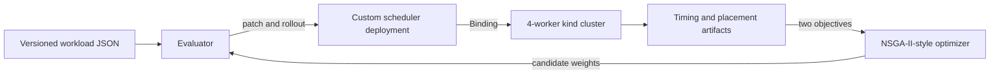

# evo-sched

`evo-sched` is a research scheduler that connects a parameterized Kubernetes
node-scoring policy to live multi-objective evolutionary search. Candidate
policies are deployed into a running kind cluster, evaluated through real Pod
bindings, and compared using scheduling-decision latency and workload
consolidation.

The central result is methodological. V2 showed that none of five optimizer
finalists selected from one-shot live measurements remained nondominated under
ten-repeat validation. V3 then compared one-shot search with deterministic
two-stage resampling under equal live-evaluation budgets. The observed false
Pareto discovery count fell from two of three finalists to one of three, but
holdout validation retained only one survivor and exposed a 43-microsecond
near-tie with a hand-designed consolidation policy. The project therefore tests
a practical noise mitigation while preserving the limits of the evidence.

## Research status

The official V2 and V3 evidence is complete and frozen in version-controlled
artifacts.

| Stage | Protocol | Main outcome |
| --- | --- | --- |
| Baselines | 4 schedulers x 3 workloads x 3 repeats | Placement character separates; default kube-scheduler is an external placement reference |
| V2 one-shot search | 216 optimizer candidates, seeds 42/123/999 | Apparent gains do not survive repeated validation |
| V3 equal-budget search | 216 fresh optimizer samples per arm, seeds 42/123/999 | One-shot evaluates 216 candidates; two-stage evaluates 126 and reallocates 90 samples to promotion |
| V3 shared validation | 6 finalists + 3 baselines x 3 workloads x 10 repeats | False Pareto discoveries are 2/3 for one-shot and 1/3 for two-stage |
| V3 survivor holdout | 3 survivors + 3 baselines x 1 workload x 10 repeats | 1/3 survivor remains; its same-worker baseline difference is a 43-microsecond near-tie |

The latency confidence intervals overlap. The false-discovery comparison has
only three finalists per arm, and the holdout is unseen to V3 selection but not
fully blinded because earlier baseline outcomes were known. The paper does not
claim statistical superiority, general optimizer effectiveness, production
generalization, or superiority over the default Kubernetes scheduler.

## System



The scheduler filters infeasible nodes before scoring. Its V2 policy uses four
nonnegative weights normalized to sum to one:

- `FreeCPU`: post-placement free CPU fraction
- `FreeMem`: post-placement free memory fraction
- `Balance`: preference for complementary CPU-memory residuals
- `Consolidation`: preference for workers already hosting managed workload Pods

The highest-scoring feasible node is selected, with node name as a deterministic
tie-breaker. Only the scoring weights change during an experiment; filtering,
workloads, cadence, and measurement contracts remain fixed.

## Repository map

| Path | Purpose |
| --- | --- |
| `scheduler/main.go` | Custom scheduler and V2 scoring implementation |
| `scheduler/cmd/evaluator` | Workload replay, rollout, cleanup, and measurements |
| `scheduler/cmd/optimizer` | NSGA-II-style candidate search |
| `scheduler/cmd/v3-official-runner` | Budget-matched, provenance-gated V3 search arms |
| `scheduler/cmd/repeated-validation-runner` | Repeated finalist and holdout protocols |
| `workloads/v2/` | Three training regimes and one unseen holdout workload |
| `experiments/weights-v2.json` | Canonical V2 baseline policies |
| `results/` | Raw JSON/CSV, summaries, checksums, and run manifests |
| `paper/main.tex` | IEEE conference paper source |
| `experiments/protocol-v3-*.json` | Frozen search, shared-validation, and holdout contracts |
| `paper/evidence-audit-v3.json` | Machine-readable V3 claim-to-evidence closure audit |
| `WALKTHROUGH.md` | Full decision, failure, recovery, and experiment ledger |

## Tested environment

The official runs record exact versions and checksums in their manifests. The
main environment was:

- Kubernetes and kind node image: `v1.35.0`
- kind: `v0.31.0`
- Go toolchain and scheduler builder: `1.25`
- `client-go`, `k8s.io/api`, and `k8s.io/apimachinery`: `v0.35.0`
- Docker Engine: `29.7.2`
- evaluator image: `busybox:1.36.1`
- topology: one control-plane and four homogeneous workers

For local verification, install Go 1.25+, Git, `jq`, `rg`, `latexmk`, `qpdf`,
and Poppler (`pdfinfo` and `pdffonts`). Live runs additionally require Docker,
kind, and kubectl with access to the `kind-evo-sched` context.

## Verify committed evidence

The fastest reproducibility path does not start Kubernetes or rerun the expensive
optimizer. It reruns tests and analysis tools, compares regenerated summaries to
the committed artifacts, rebuilds the paper, and checks the PDF:

```bash
make verify
```

This command writes only to a temporary directory and ignored LaTeX build files.
It reruns Go tests and vet, regenerates all three V3 analyses, verifies current
input checksums plus the tagged historical search-protocol snapshot, race-checks
the V3 analyzers, rebuilds the six-page paper, and checks the PDF and evidence
audit. The historical V2 gate remains available as `make verify-v2`.

Individual checks are also available:

```bash
make test
make vet
make paper
```

## Live smoke test

The following command starts or creates the 4-worker cluster, builds and loads
the scheduler image, deploys RBAC and the scheduler, and runs a small V2 wiring
smoke test:

```bash
make live-smoke
```

This is a functional check, not paper evidence. It leaves the cluster running so
the scheduler and logs can be inspected:

```bash
kubectl -n evo-sched get pods
kubectl -n evo-sched logs deployment/evok8s-scheduler
```

Stop the kind containers without deleting cluster state when finished:

```bash
make cluster-stop
```

## Live protocol reproduction

Official runners intentionally refuse dirty working trees and require the
annotated protocol tag at `HEAD`. They also reject cluster topology, scheduler
cadence, canonical-weight, rollout, namespace-cleanliness, checksum, or command
drift. Never overwrite the committed official directories or reuse an archived
run identity for new evidence.

Prepare the cluster and the 250 ms experiment cadence:

```bash
make cluster-up
make scheduler-image
make scheduler-deploy
cd scheduler
go run ./cmd/scheduler-admin --interval 250ms
cd ..
```

The archived V3 identities and exact command arrays are in
`experiments/protocol-v3-budget-matched-resampling.json` and
`experiments/protocol-v3-survivor-holdout.json`. Search uses
`scheduler/cmd/v3-official-runner`; shared validation and holdout use
`scheduler/cmd/repeated-validation-runner`. New official evidence requires a new
protocol version, run name, result directory, annotated tag, and matching
contract tests before execution. `WALKTHROUGH.md` records the full freeze,
preflight, tmux, interruption recovery, acceptance, and postflight sequence.

A full V3 reproduction is expensive. The official search alone executes 1,350
workload replays and 32,400 Pods; shared validation adds 270 replays and 6,480
Pods, and survivor holdout adds 60 replays and 1,440 Pods. Use `make live-smoke`
for wiring checks and `make verify` for committed evidence unless a new live
protocol has deliberately been frozen.

## Evidence and paper

The historical V2 evidence directories are:

- `results/2026-08-28-v2-official-baselines`
- `results/2026-08-28-v2-official-optimizer-3seed`
- `results/2026-08-28-v2-official-finalist-validation`
- `results/2026-08-29-v2-official-holdout-baselines`

The official V3 evidence directories are:

- `results/2026-09-07-v3-budget-matched-official-search`
- `results/2026-09-07-v3-shared-validation`
- `results/2026-09-08-v3-survivor-holdout`

Build the six-page paper with `make paper`. The generated `paper/main.pdf` is
ignored; the LaTeX source, figures, IEEE class file, raw artifacts, and closure
audit are versioned.

## Package release artifacts

The current packaging target preserves the historical V2 evidence release. From
a clean `research/policy-space-v2` checkout:

```bash
make release-package RELEASE_OUTPUT=/tmp/evo-sched-v2-release
```

This reruns `make verify`, checks that the four annotated protocol tags are
ancestors of `HEAD`, and produces:

- `evo-sched-v2-paper.pdf`
- `evo-sched-v2-official-evidence.tar.gz`
- `evo-sched-v2-release-manifest.json`
- `SHA256SUMS`

The evidence archive contains only the four V2 official result directories and
`paper/evidence-audit-v2.json`; pilot and debug artifacts are excluded. Packaging
does not push refs, create a GitHub release, or upload assets. Public availability
must be verified separately against the intended remote release. A stable V3
release bundle is still a publication gate; do not use the V2 bundle as support
for V3 claims.

## Build the KubeCon evidence figure

The standalone two-panel figure contrasts V3 shared-validation false discoveries
with the survivor holdout result:

```bash
make killer-figure
```

The vector PDF is written to
`presentation/kubecon-europe-2027/killer-figure.pdf` and is intentionally
ignored. It imports the same TikZ source used by the paper, preventing numerical
or visual drift between the manuscript and presentation. The historical V2
one-shot collapse figure remains versioned separately for the talk's motivation.

The 25-minute talk plan, 5-minute question window, claim boundaries, and
time-coded four-minute English speaking sample are stored in
`presentation/kubecon-europe-2027/talk-package.json`.

## Limitations

- kind workers are homogeneous containers on one physical host.
- Workloads are synthetic, short, and request-driven.
- Maximum workload-occupied workers is a consolidation proxy, not powered-node
  cost.
- Requested-load variance is derived from Pod requests, not measured hardware
  utilization.
- The default kube-scheduler does not emit the custom decision timestamp, so it
  is not used as a direct latency baseline.
- Optimizer hyperparameters were fixed. One-shot candidates use one live sample;
  two-stage promotion averages four samples but explores fewer unique candidates.
- Each replay contains 24 Pods, so interpolated p95 remains sensitive to a few
  upper-tail observations.
- V3 compares only three selected finalists per arm and supports descriptive,
  not inferential, mitigation conclusions.

## License

Copyright 2026 Ismail Tarim. Licensed under the Apache License 2.0. See
`LICENSE`.
